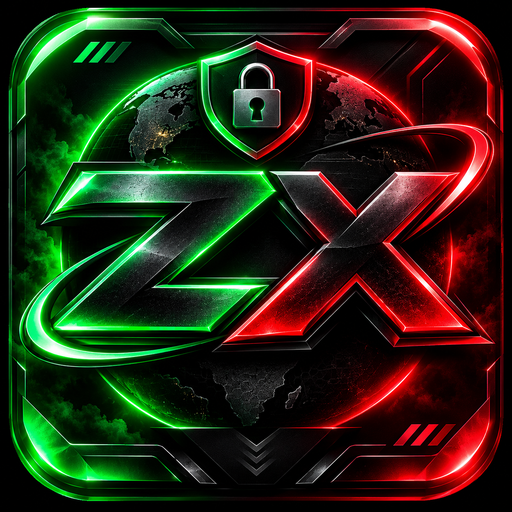
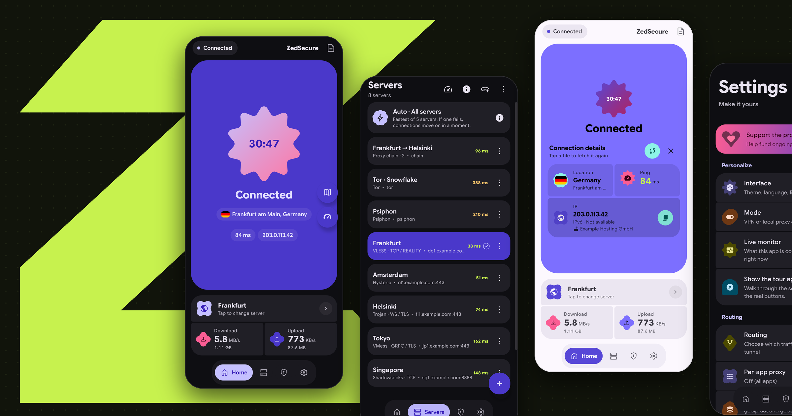

  

<h1 align="center">ZX VPN</h1>

<strong>همهٔ راه‌های اتصال، در یک برنامه.</strong>

  
  

<a href="README.md">English</a> · <b>فارسی</b>

ZX VPN یک کلاینت چند‌هسته‌ای VPN و پروکسی است. این پروژه چند موتور ارتباطی و روش اتصال را در یک
رابط واحد گرد هم می‌آورد تا مدیریت کانفیگ‌ها، اشتراک‌ها، تنظیمات تونل و ابزارهای بررسی اتصال بدون
نیاز به جابه‌جایی میان چند برنامه انجام شود.

  

> **وضعیت پروژه:** در دسترس بودن هسته‌ها و قابلیت‌ها به سیستم‌عامل، نوع بیلد و نسخهٔ منتشرشده
> بستگی دارد. فهرست زیر معماری و یکپارچه‌سازی‌های پروژه را توضیح می‌دهد و به معنی فعال بودن تمام
> پروتکل‌ها در همهٔ سیستم‌عامل‌ها یا آزمایش کامل آن‌ها روی تمام دستگاه‌ها نیست. پیش از اتکا به یک
> هستهٔ مشخص، توضیحات همان نسخه را بررسی کنید.

## فهرست مطالب
- [معرفی و قابلیت‌های اصلی](#معرفی-و-قابلیت‌های-اصلی)
- [هسته‌ها و پروتکل‌ها](#هسته‌ها-و-پروتکل‌ها)
- [یکپارچه‌سازی Aether](#یکپارچه‌سازی-aether)
- [GHOST MOD](#ghost-mod)
- [تم‌ها](#تم‌ها)
- [وارد کردن و مدیریت کانفیگ](#وارد-کردن-و-مدیریت-کانفیگ)
- [ابزارهای اتصال](#ابزارهای-اتصال)
- [پشتیبانی سیستم‌عامل‌ها](#پشتیبانی-سیستم‌عامل‌ها)
- [دانلود و نصب](#دانلود-و-نصب)
- [ساخت از سورس](#ساخت-از-سورس)
- [ساختار مخزن](#ساختار-مخزن)
- [رفع اشکال](#رفع-اشکال)
- [حریم خصوصی و امنیت](#حریم-خصوصی-و-امنیت)
- [اعتبارها و پروژه‌های متن‌باز](#اعتبارها-و-پروژه‌های-متن‌باز)
- [مجوز](#مجوز)

## معرفی و قابلیت‌های اصلی

- **معماری چند‌هسته‌ای:** چند موتور VPN، پروکسی و تونل در یک برنامه.
- **مدیریت کانفیگ:** وارد کردن، دسته‌بندی و استفاده از لینک‌ها و فایل‌های پشتیبانی‌شده.
- **اشتراک‌ها:** مدیریت منابع اشتراک و به‌روزرسانی فهرست سرورها در حالت‌های پشتیبانی‌شده.
- **آزمایش سرورها:** بررسی سرورهای موجود و انتخاب گزینهٔ پاسخ‌گو؛ رفتار جابه‌جایی خودکار به حالت اتصال
  و سیستم‌عامل بستگی دارد.
- **اتصال زنجیره‌ای:** عبور دادن ترافیک یک هسته از مسیر هستهٔ دیگر، در ترکیب‌های پشتیبانی‌شده.
- **مسیریابی برنامه‌ای:** انتخاب برنامه‌هایی که در اندروید از تونل VPN عبور می‌کنند.
- **مسیریابی پیشرفته:** ویرایش قوانین مبتنی بر GeoIP و GeoSite در هسته‌های سازگار.
- **ابزارهای DNS:** حالت‌های تونل DNS، بررسی رزالورها و تنظیمات مرتبط با DNS.
- **عیب‌یابی اتصال:** گزارش زنده، تست سرعت و ابزار یافتن MTU.
- **اشتراک‌گذاری Vault:** بسته‌های کانفیگ با پسوند .zsx و امکان رمزگذاری و تاریخ انقضای اختیاری.
- **رابط مدرن:** طراحی Material 3 Expressive، پوستهٔ روشن و تاریک و رابط چندزبانه.
- **نسخهٔ دسکتاپ:** ساختار مشترک پروژه و رابط کاربری برای نسخه‌های پشتیبانی‌شدهٔ لینوکس، ویندوز و مک.

## هسته‌ها و پروتکل‌ها

جدول زیر خلاصه‌ای از یکپارچه‌سازی‌های مستندشده در پروژه است. قابلیت واقعی هر مورد به سیستم‌عامل
و هسته‌ای که در بیلد موردنظر قرار گرفته بستگی دارد.

| هسته / مؤلفه | کاربردها و پروتکل‌های مستندشده |
|---|---|
| **Xray** | VLESS شامل حالت‌های Reality و Vision و XHTTP، همچنین VMess، Trojan، Shadowsocks، Hysteria2 و کانفیگ‌های سازگار WireGuard و AmneziaWG |
| **sing-box** | TUIC، Naive، AnyTLS، ShadowTLS، فایل‌های OpenVPN با پسوند .ovpn و JSON مخصوص sing-box |
| **Psiphon** | اتصال از طریق شبکهٔ اختصاصی Psiphon؛ نیازی به وارد کردن سرور شخصی نیست |
| **Tor** | اتصال Tor و ترنسپورت‌های پل از جمله obfs4، Snowflake و Conjure، با توجه به محتوای بیلد |
| **تونل‌های DNS** | حالت‌های DNSTT، VayDNS و MasterDNS؛ ترنسپورت‌های پشتیبانی‌شده شامل UDP، TCP، DoT و DoH |
| **OpenConnect** | اتصال به درگاه‌های سازگار با Cisco AnyConnect |
| **IKEv2** | یکپارچه‌سازی VPN مبتنی بر IPsec/IKEv2 سیستم‌عامل اندروید |
| **SSH** | تونل SSH مستقل و سناریوهای زنجیره‌ای پشتیبانی‌شده |
| **Aether در اندروید** | یکپارچه‌سازی افزودهٔ اندرویدی بر پایهٔ Aether از Cluvex و مؤلفه‌های Native پچ‌شدهٔ QW؛ آمادگی ساخت و اجرای آن به نسخه وابسته است. |

## یکپارچه‌سازی Aether

در سورس اندروید شاخهٔ ZX مسیر یکپارچه‌سازی Aether قرار دارد که با هدف ترکیب دو خط توسعهٔ Aether
در قالب یک ورودی هسته طراحی شده است:

- سورس CluvexStudio Aether به‌عنوان پایهٔ بالادستی استفاده می‌شود.
- مؤلفه‌های Native مشتق‌شده از Aether پروژهٔ QW-AI-Code و سازگارسازی وابستگی‌ها در درخت سورس
  ادغام‌شدهٔ مورد استفاده در بیلد اندروید قرار گرفته‌اند.
- اسکریپت ساخت اندروید، یکسان بودن نسخهٔ هستهٔ بالادستی و نسخهٔ ادغام‌شده و وجود نشانگر سطح پچ را
  بررسی می‌کند؛ سپس فایل اجرایی Native را برای ABIهای تعیین‌شده می‌سازد و وابستگی‌های پویا را پیش
  از بسته‌بندی بررسی می‌کند.
- تنظیمات و مدل پروفایل Aether از پروفایل هسته‌های دیگر جدا نگه داشته شده‌اند.

این بخش معماری و مسیر ساخت را توضیح می‌دهد و به معنی آماده بودن قطعی برای استفادهٔ عملیاتی نیست.
موفقیت کامپایل یا تولید APK به‌تنهایی ثابت نمی‌کند که تونل VPN روی دستگاه واقعی به‌درستی متصل
می‌شود. اتصال واقعی، مسیریابی و چرخهٔ عمر سرویس باید برای هر نسخه جداگانه آزمایش شوند.

پروژه‌های اصلی:
[CluvexStudio/Aether](https://github.com/CluvexStudio/Aether) ·
[QW-AI-Code/Aether](https://github.com/QW-AI-Code/Aether)

### کانفیگ هوشمند

**سرورها ← «+» ← کانفیگ هوشمند** یک پروفایل آمادهٔ Aether را بر اساس شبکهٔ خود شما می‌سازد:

- نوع شبکه (دیتای موبایل، وای‌فای، شبکهٔ سیمی)، کشور و وضعیت IPv6 را تشخیص می‌دهد.
- دسترسی به لبهٔ Cloudflare و API ثبت‌نام WARP را به‌صورت موازی و سریع (حداکثر حدود ۳٫۵ ثانیه) آزمایش
  می‌کند و هر مرحله را همراه با تأخیرش زنده نشان می‌دهد.
- انتقال (HTTP/3 یا HTTP/2)، پروفایل ضد DPI (`noize`)، عمق اسکن، فرگمنت‌کردن ClientHello و آدرس
  جایگزین API برای ثبت‌نام (وقتی آدرس پیش‌فرض بسته است) را انتخاب می‌کند.
- پروفایل را با یک ضربه می‌سازد و فعال می‌کند، یا ویرایشگر دستی را با مقادیر پر‌شده باز می‌کند.

### نردبان اتصال

هنگام شروع یک پروفایل Aether، ابتدا خود پروفایل و سپس نسخه‌های محافظه‌کارانه‌تر آن (نسخهٔ دیگر HTTP،
ClientHello فرگمنت‌شده با قوی‌ترین پنهان‌سازی، آدرس جایگزین API، WireGuard و حالت ساده) امتحان می‌شود تا
ترافیک واقعی از SOCKS محلی عبور کند. اگر هیچ‌کدام جواب ندهد، پیام خطا شامل آخرین خطوط خروجی موتور است
تا بتوان علت را گزارش کرد.

> نردبان و کانفیگ هوشمند شانس اتصال را در شبکه‌های فیلترشده بالا می‌برند، ولی اتصال را تضمین نمی‌کنند.
> برای هر نسخه روی دستگاه واقعی آزمایش کنید.

## GHOST MOD

GHOST MOD ابزارهای ضدسانسور ZX را کنار هم می‌آورد: تنظیم ضد DPI، تنظیم‌گر خودکار و گزینه‌های مرتبط
(توضیحات داخل برنامه). همچنین **ضد پورن** (مرور امن برای خانواده) را دارد:

- سایت‌ها و کلیدواژه‌های بزرگسالان را در لایهٔ مسیریابی می‌بندد و از DNS خانوادگی استفاده می‌کند.
- نشانی‌های شناخته‌شدهٔ DNS-over-HTTPS را می‌بندد تا مرورگرها فیلتر DNS را دور نزنند.
- امکان افزودن دامنه‌های دلخواه برای مسدودسازی (تا ۵۰۰ مورد) را می‌دهد.

ضد پورن یک فیلتر در حد توان است: دسترسی با IP مستقیم یا از طریق VPN دیگر خارج از دسترس آن است.

## تم‌ها

ZX VPN چند طراحی کامل دارد که از تنظیمات انتخاب می‌شود:

| طراحی | ویژگی |
|---|---|
| **Bento** | کاشی‌های گرد و ظاهر آرام Material 3 Expressive |
| **Pixel** | چیدمان با حال‌وهوای Pixel/Material You |
| **Old** | چیدمان کلاسیک |
| **ZX** | طراحی نئونی سایبرپانک با حالت روز/شب، سطح انیمیشن قابل تنظیم و صفحهٔ اصلی به سبک PS5 (ردیف کارت‌ها، پس‌زمینهٔ پویا، نمادهای دکمه) |
| **ZX PS** | طراحی شیشه‌ای با پالت و شکل کاشی قابل شخصی‌سازی و نوار ناوبری شیشه‌ای شناور |

آیکون برنامه و نام آن («ZX VPN») در همهٔ تم‌ها یکسان است.

## وارد کردن و مدیریت کانفیگ

با توجه به سیستم‌عامل و هستهٔ فعال، موارد زیر قابل وارد کردن یا باز کردن هستند:

- لینک‌های اشتراک‌گذاری VLESS، VMess، Trojan، Shadowsocks و قالب‌های سازگار دیگر.
- کانفیگ‌های JSON مربوط به Xray و sing-box.
- منابع اشتراک پشتیبانی‌شده.
- فایل‌های OpenVPN با پسوند .ovpn.
- لینک‌های کانفیگ Amnezia با پیشوند vpn://.
- کدهای QR شامل لینک یا دادهٔ کانفیگ پشتیبانی‌شده.
- بسته‌های Vault برنامه با پسوند .zsx.
- فایل‌ها و لینک‌های محلی که از طریق اشتراک‌گذاری یا فایل‌منیجر اندروید باز می‌شوند.

یک کانفیگ تنها زمانی قابل استفاده است که قالب آن شناسایی شده باشد و هستهٔ مربوطه در نسخهٔ نصب‌شده
وجود داشته باشد. وارد کردن کانفیگ، معتبر بودن اطلاعات یا در دسترس بودن سرور مقصد را تضمین نمی‌کند.

## ابزارهای اتصال

### آزمایش و انتخاب سرور
ابزارهای تست سرور و انتخاب خودکار به مقایسهٔ مقصدهای موجود کمک می‌کنند. نتیجه به وضعیت شبکه،
حل DNS، پاسخ سرور و روش آزمایش وابسته است. تأخیر کمتر لزوماً به معنی سرعت پایدار یا اتصال قابل
اعتمادتر نیست.

### اتصال زنجیره‌ای
در ترکیب‌هایی که هسته‌ها پشتیبانی می‌کنند، می‌توان مسیر یک پروکسی را از پروکسی دیگری عبور داد.
از نمونه‌های معماری پروژه می‌توان به Xray از طریق Tor و Tor از طریق Xray اشاره کرد. ترکیب‌های
قابل استفاده به پلتفرم و پیاده‌سازی هسته‌ها وابسته‌اند.

### ابزارهای DNS و رزالور
ابزارهای DNS شامل حالت‌های تونل DNS و بررسی رزالورها هستند. پیاده‌سازی تونل DNS علاوه بر اجزای
متن‌باز مورد استفاده، موتور اختصاصی zeddns پروژه را نیز در بر می‌گیرد. تست رزالور صرفاً یک ابزار
تشخیصی است و کارکرد آن رزالور را در همهٔ شبکه‌ها تضمین نمی‌کند.

### مسیریابی برنامه‌ای و پیشرفته
نسخه‌های اندروید کنترل مسیریابی VPN برای هر برنامه را دارند. قوانین GeoIP و GeoSite و گزینه‌های
پیشرفته‌ای مانند SNI spoofing به هستهٔ مربوطه، مجوزهای سیستم‌عامل و برای عملیات نیازمند روت،
دسترسی روت دستگاه وابسته‌اند.

### اشتراک‌گذاری Vault
بسته‌های Vault با پسوند .zsx طراحی شده‌اند تا کانفیگ را بدون نمایش مستقیم محتوای آن در روند عادی
اشتراک‌گذاری منتقل کنند. رمز عبور و اطلاعات انقضا اختیاری هستند. فایل خروجی را محرمانه در نظر
بگیرید؛ ممکن است شامل اطلاعات ورود، نشانی سرور یا داده‌های خصوصی اتصال باشد.

## پشتیبانی سیستم‌عامل‌ها

| سیستم‌عامل | پوشش هسته‌ها در سطح پروژه | قالب انتشار |
|---|---|---|
| **Android** | Xray، sing-box، Psiphon، Tor، تونل‌های DNS، OpenConnect، IKEv2، SSH و مسیر یکپارچه‌سازی Aether | APK جداگانه برای ABIهای arm64-v8a، armeabi-v7a و x86_64 |
| **Linux** | Xray، sing-box، تونل‌های DNS و SSH | .deb، .rpm، .AppImage و .tar.gz |
| **Windows** | Xray، sing-box، تونل‌های DNS و SSH | نصب‌کنندهٔ .msi و نسخهٔ قابل‌حمل .zip |
| **macOS** | Xray، sing-box، تونل‌های DNS و SSH | فایل .dmg برای Apple Silicon و Intel |

این جدول نمای کلی پروژه است و فعال بودن تمام امکانات را در همهٔ نسخه‌ها تضمین نمی‌کند. برای
اطلاع از محتوای دقیق هر بیلد، توضیحات همان انتشار را بخوانید.

## دانلود و نصب

نسخه‌های منتشرشده را از صفحهٔ رسمی
[GitHub Releases](https://github.com/hajighmony-sudo/Zx/releases) دریافت کنید.

### اندروید
۱. وارد صفحهٔ Releases شوید.
۲. فایل APK متناسب با معماری دستگاه را انتخاب کنید:
- **arm64-v8a:** بیشتر گوشی‌ها و تبلت‌های جدید اندرویدی.
- **armeabi-v7a:** دستگاه‌های قدیمی‌تر با پردازندهٔ ARM سی‌ودوبیتی.
- **x86_64:** دستگاه‌های اندرویدی x86-64 و برخی محیط‌های شبیه‌ساز.
۳. APK را نصب کنید و هنگام شروع اتصال، مجوز VPN نمایش‌داده‌شده توسط اندروید را بررسی و تأیید کنید.

فقط فایل‌هایی را نصب کنید که از منبع مورد اعتماد دریافت کرده‌اید. اگر برای نسخه‌ای checksum
منتشر شده است، پیش از نصب آن را بررسی کنید.

### لینوکس
قالب سازگار با توزیع خود را انتخاب کنید: DEB، RPM، AppImage یا TAR.GZ. مراحل نصب معمول توزیع
خود را دنبال کنید و در صورت نیاز مجوزهای شبکه را فراهم کنید.

### ویندوز
برای نصب عادی از MSI و برای اجرای قابل‌حمل از ZIP استفاده کنید. برخی عملیات مربوط به VPN و
درایورهای شبکه ممکن است به سطح دسترسی Administrator نیاز داشته باشند.

### مک
فایل DMG متناسب با Apple Silicon یا Intel را انتخاب کنید. طبق مستندات فعلی پروژه، برنامهٔ macOS
notarize نشده است؛ بنابراین ممکن است هنگام اجرای نخست هشدار امنیتی نمایش داده شود. تنها در صورتی
ادامه دهید که از دریافت فایل از انتشار رسمی پروژه مطمئن شده‌اید.

## ساخت از سورس

### پیش‌نیازها

برای ساخت نسخهٔ اندروید:

- Git با پشتیبانی از submodule.
- JDK 21 مطابق پیکربندی فعلی CI.
- Android SDK و Android NDK.
- ابزار Rust با نسخهٔ stable.
- تارگت‌های Rust شامل aarch64-linux-android، armv7-linux-androideabi و x86_64-linux-android.
- ابزار cargo-ndk برای ساخت Native هستهٔ Aether در شاخهٔ ZX.
- Python 3 برای ابزار پچ و بررسی وابستگی‌های Aether.
- ابزارهای Build مربوط به Android SDK و Gradle Wrapper موجود در مخزن.

برای دسکتاپ، JDK سازگار و وابستگی‌های بسته‌بندی Native مورد نیاز سیستم‌عامل مقصد و ابزار Compose
Desktop را نصب کنید.

### دریافت مخزن

مخزن را همراه submoduleها دریافت کنید تا سورس‌های Native پین‌شده نیز دریافت شوند:

~~~sh
git clone --recurse-submodules https://github.com/hajighmony-sudo/Zx.git
cd Zx
git checkout ZX
git submodule update --init --recursive
~~~

### ساخت نسخهٔ Debug اندروید

در شاخهٔ ZX، پیش از بسته‌بندی برنامه توسط Gradle باید هستهٔ Native مربوط به Aether ساخته شود:

~~~sh
rustup toolchain install stable --profile minimal
rustup default stable
rustup target add aarch64-linux-android armv7-linux-androideabi x86_64-linux-android
cargo install cargo-ndk --locked

bash ./tools/build-aether-engine.sh
./tools/get-cores.sh android
./gradlew --no-daemon :app:assembleDebug
~~~

ساخت Debug برای ABIهای جداگانه APK تولید می‌کند. در صورت موفقیت Workflow مربوط به CI، امضای APKها
بررسی شده و فایل‌های APK به همراه فایل checksum از نوع SHA-256 به‌عنوان Artifact در دسترس قرار
می‌گیرند.

### ساخت نسخهٔ Release اندروید

~~~sh
bash ./tools/build-aether-engine.sh
./tools/get-cores.sh android
./gradlew :app:assembleRelease
~~~

امضای نسخهٔ Release به تنظیمات keystore محلی وابسته است. کلید امضا، رمز keystore و اطلاعات
محرمانه را هرگز در مخزن ثبت نکنید.

### ساخت بسته‌های دسکتاپ

ابتدا هسته‌های پین‌شدهٔ سیستم‌عامل مقصد را دریافت و سپس وظیفهٔ بسته‌بندی Gradle را اجرا کنید:

~~~sh
./tools/get-cores.sh linux
./gradlew :desktop:packageDeb
./gradlew :desktop:packageRpm
./gradlew :desktop:packageAppImage
~~~

برای ویندوز از هدف windows و وظیفهٔ :desktop:packageMsi استفاده کنید. برای مک از macos-arm64
یا macos-x86_64 و وظیفهٔ :desktop:packageDmg استفاده کنید.

### نسخه‌های پین‌شدهٔ هسته‌ها
پروژه برای ساخت از نسخه‌ها و کامیت‌های مشخص‌شدهٔ هسته‌ها استفاده می‌کند و به دریافت تصادفی آخرین
نسخهٔ بالادستی متکی نیست. فهرست هسته‌ها در فایل
[tools/cores.txt](tools/cores.txt) نگهداری می‌شود. اسکریپت‌های ساخت و Workflowهای انتشار مشخص
می‌کنند که برای هر سیستم‌عامل از کدام سورس یا فایل از پیش ساخته‌شده استفاده شود.

## ساختار مخزن

| مسیر | کاربرد |
|---|---|
| app/ | برنامهٔ اندروید، سرویس VPN، یکپارچه‌سازی‌های سیستمی و منابع اندروید |
| shared/ | منطق مشترک Kotlin Multiplatform، مدل‌های کانفیگ و رابط کاربری |
| desktop/ | برنامهٔ Compose Desktop و تنظیمات بسته‌بندی |
| gradle/ | کاتالوگ نسخه‌ها و پیکربندی Gradle |
| tools/ | اسکریپت‌های دریافت هسته، ساخت Native و نگهداری پروژه |
| native/ | سورس هسته‌های Native و submoduleها، از جمله سورس‌های مرتبط با Aether |
| .github/workflows/ | Workflowهای CI برای ساخت و انتشار |
| docs/ | تصاویر و منابع مستندات پروژه |
| NOTICE | اطلاعیه‌ها و ارجاع مجوز نرم‌افزارهای ثالث |
| LICENSE | مجوز اصلی پروژه |

## رفع اشکال

### هسته‌ای در ساخت اندروید پیدا نمی‌شود
ابتدا submoduleها را مقداردهی اولیه کنید و سپس اسکریپت دریافت هستهٔ اندروید را اجرا کنید:

~~~sh
git submodule update --init --recursive
./tools/get-cores.sh android
~~~

بررسی کنید فایل‌های مورد نیاز وجود داشته باشند و مرحلهٔ دریافت بدون خطا تمام شده باشد.

### اسکریپت Aether، NDK را پیدا نمی‌کند
Android NDK را نصب کنید و متغیر ANDROID_NDK_HOME را روی مسیر نصب آن قرار دهید. اسکریپت
مسیر پیش‌فرض NDK در Android SDK را نیز بررسی می‌کند. در CI لینوکسی مطمئن شوید NDK شامل ابزارهای
میزبان Linux باشد.

### تارگت Rust پیدا نمی‌شود
تارگت متناسب با ABI اندروید را نصب کنید:

~~~sh
rustup target add aarch64-linux-android armv7-linux-androideabi x86_64-linux-android
~~~

همچنین مطمئن شوید cargo-ndk نصب شده و در PATH قرار دارد.

### بررسی نسخه یا Patch Level هستهٔ Aether ناموفق است
این بررسی را دور نزنید. هدف آن جلوگیری از ساخت ترکیب ناسازگار نسخهٔ بالادستی و نسخهٔ ادغام‌شده
یا ساخت مجموعه پچ ناشناس است. submoduleهای موردنظر و اطلاعات نسخه و Patch Level ادغام Aether را
بررسی و سپس دوباره Build کنید.

### APK ساخته می‌شود اما VPN متصل نمی‌شود
موفقیت Gradle فقط کامپایل و بسته‌بندی را تأیید می‌کند، نه اتصال کامل و واقعی را. گزارش داخل
برنامه، هستهٔ انتخاب‌شده، قالب کانفیگ، در دسترس بودن سرور و مجوز VPN اندروید را بررسی کنید.
برای Aether نیز مطمئن شوید همان نسخه، آزمایش اتصال تونل و مسیریابی روی دستگاه واقعی را گذرانده
باشد.

### بسته‌بندی دسکتاپ خطا می‌دهد
وظیفهٔ بسته‌بندی را روی سیستم‌عامل میزبان پشتیبانی‌شده اجرا کنید، در دسترس بودن JDK را بررسی
کنید و ابزارهای Native موردنیاز سیستم‌عامل مقصد را نصب کنید. به‌جای توجه صرف به خط نهایی خروجی،
اولین وظیفهٔ Gradle که شکست خورده است را بررسی کنید.

### گزارش یک مشکل قابل بازتولید
هنگام ثبت Issue این موارد را درج کنید:
- نسخهٔ ZX و سیستم‌عامل.
- معماری دستگاه یا نسخهٔ سیستم‌عامل.
- هستهٔ انتخاب‌شده و نوع کانفیگ (بدون اطلاعات محرمانه).
- مراحل بازتولید مشکل.
- متن خطا یا بخشی از لاگ که اطلاعات حساس آن حذف شده باشد.
- اینکه مشکل پس از نصب تمیز رخ می‌دهد یا پس از به‌روزرسانی.

رمز عبور، کلید خصوصی، لینک اشتراک، Access Token یا فایل کانفیگ بدون حذف اطلاعات محرمانه را در
Issue عمومی قرار ندهید.

## حریم خصوصی و امنیت

- استفاده از VPN به مجوز سیستم‌عامل نیاز دارد و ممکن است ترافیک دستگاه را از مقصد راه دور انتخاب‌شده
  عبور دهد.
- فقط کانفیگ‌ها و لینک‌های اشتراک منابع مورد اعتماد را وارد کنید.
- لینک‌های اشتراک، URLهای اشتراک، بسته‌های Vault و لاگ‌های تشخیصی را اطلاعات بالقوه محرمانه
  در نظر بگیرید.
- پیش از اتصال، مسیریابی برنامه‌ای و تنظیمات DNS را بررسی کنید؛ به‌ویژه روی دستگاه‌های مشترک یا
  مدیریت‌شده.
- قابلیت‌های نیازمند روت فقط با دسترسی روت کار می‌کنند و باید با آگاهی از اثر آن‌ها فعال شوند.
- ZX VPN یک برنامهٔ کلاینت است؛ معتبر بودن سرور ناشناس، ناشناس‌ماندن کامل، مقاومت قطعی در برابر
  فیلترینگ، سرعت یا اتصال بدون وقفه را تضمین نمی‌کند.
- از نرم‌افزار مطابق قوانین محل استفاده و شرایط سرویس‌ها و شبکه‌هایی که به آن‌ها متصل می‌شوید
  استفاده کنید.

## اعتبارها و پروژه‌های متن‌باز

ZX VPN با استفاده از پروژه‌های متن‌باز ساخته شده است. از مهم‌ترین مؤلفه‌های بالادستی:

- [Xray-core](https://github.com/XTLS/Xray-core)
- [sing-box](https://github.com/SagerNet/sing-box)
- [Psiphon Tunnel Core](https://github.com/Psiphon-Labs/psiphon-tunnel-core)
- [Tor Project](https://www.torproject.org/)
- [MasterDnsVPN](https://github.com/masterking32/MasterDnsVPN)
- [AmneziaWG](https://github.com/amnezia-vpn/amneziawg-go)
- [OpenConnect](https://www.infradead.org/openconnect/)
- [hev-socks5-tunnel](https://github.com/heiher/hev-socks5-tunnel)
- [zeptun](https://github.com/Noisemux/zeptun)
- [VayDNS](https://github.com/net2share/vaydns)
- [dnstt](https://www.bamsoftware.com/software/dnstt/)
- [SlipNet](https://github.com/anonvector/SlipNet) که ایده‌های طراحی و مؤلفه‌های تاریخی مرتبط با
  پیاده‌سازی تونل DNS آن مورد قدردانی قرار گرفته‌اند.
- [CluvexStudio Aether](https://github.com/CluvexStudio/Aether) و
  [QW-AI-Code Aether](https://github.com/QW-AI-Code/Aether) در مسیر یکپارچه‌سازی Aether اندروید.

پیاده‌سازی تونل DNS شامل موتور اختصاصی zeddns پروژه است. نسخه‌های قبل از 3.0.9 از اجزای موتور
SlipNet استفاده می‌کردند؛ از نسخهٔ 3.0.9 به بعد، پروژه پیاده‌سازی اختصاصی zeddns را مستند کرده
و در عین حال اعتبار ایده‌ها و اجزای الهام‌بخش آن را حفظ می‌کند.

برای اطلاع از جزئیات مجوزها، پچ‌ها و ارجاع به پروژه‌های ثالث، فایل [NOTICE](NOTICE) را بخوانید.
هر مؤلفهٔ بالادستی همچنان تابع مجوز مخصوص خود است.

## مجوز

مجوز اصلی پروژه [GNU Affero General Public License نسخهٔ 3.0](LICENSE) یا AGPL-3.0 است.
برخی مؤلفه‌های بسته‌بندی‌شده یا لینک‌شده مجوزهای جداگانه دارند که در فایل
[NOTICE](NOTICE) توضیح داده شده‌اند. پیش از انتشار مجدد نسخهٔ تغییر‌یافته، مجوز مؤلفه‌های
مرتبط را نیز بررسی کنید.

