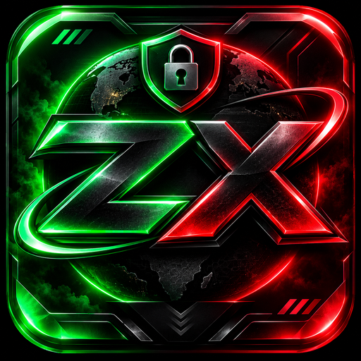
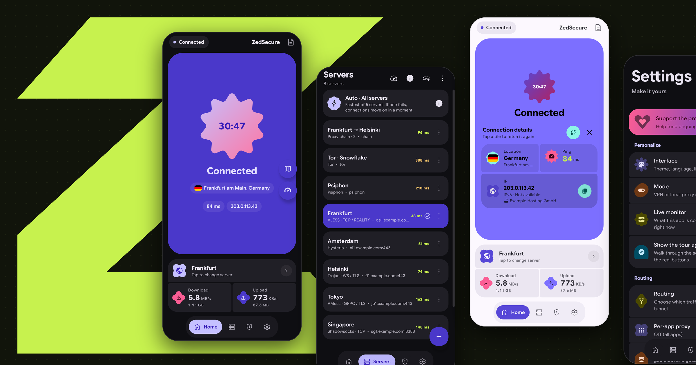

<p align="center">
  
</p>

<h1 align="center">ZedSecure</h1>

<p align="center">あらゆる抜け道を、ひとつのアプリに。</p>

<p align="center">
  <a href="https://github.com/CluvexStudio/ZedSecure/releases/latest"></a>
  <a href="https://play.google.com/store/apps/details?id=com.zedsecure.vpn"></a>
  
  <a href="LICENSE"></a>
</p>

<p align="center"><a href="README.md">English</a> · <a href="README.fa.md">فارسی</a> · <b>日本語</b></p>

## ZedSecure とは？

ZedSecure は Android、Linux、Windows、macOS 向けの VPN・プロキシクライアントで、複数のエンジンを搭載しています。あるルートがブロックされても、次のルートがすでにインストールされています。一般的なプロトコルには Xray と sing-box、ほかに何もつながらないときには Psiphon と Tor、DNS 以外ほとんど通さないネットワークには DNS トンネル、すでに運用しているサーバーには WireGuard、AmneziaWG、OpenConnect、IKEv2 を使えます。エンジン同士を連結（チェーン）でき、ワンタップですべてのサーバーをテストして、最も速いサーバーに接続を切り替えます。

<p align="center">
  
</p>

## エンジン

| エンジン | 対応内容 |
|---|---|
| Xray | Reality、Vision、XHTTP 付きの VLESS、VMess、Trojan、Shadowsocks、Hysteria2、WireGuard、AmneziaWG |
| sing-box | TUIC、Naive、AnyTLS、ShadowTLS、OpenVPN の `.ovpn` ファイル、素の sing-box JSON |
| Psiphon | Psiphon 独自のネットワーク。自前のサーバーは不要です |
| Tor | obfs4、Snowflake、Conjure ブリッジ |
| DNS トンネル | DNSTT、VayDNS、MasterDNS（UDP、TCP、DoT、DoH 経由） |
| OpenConnect | Cisco AnyConnect および互換ゲートウェイ |
| IKEv2 | Android 組み込みの IPsec クライアント |
| SSH | 単体で、または上記いずれかを経由して |

Android ではすべてのエンジンを使えます。Linux、Windows、macOS では Xray、sing-box、DNS トンネル、SSH を使えます。

## 機能

- 共有リンク、サブスクリプション、Xray および sing-box の JSON、`.ovpn`、Amnezia の `vpn://`、QR コードをインポートできます
- 自動選択により、トンネルを最も速いサーバーに保ち、障害時には自動でフェイルオーバーします
- 双方向のチェーンに対応しています（例：Xray over Tor、Tor over Xray）
- アプリごとのルーティング、geoip/geosite ルールエディター、root 化デバイスでの SNI スプーフィング
- Vault：設定を中身を見せずに接続できる `.zsx` ファイルとして共有できます。パスワードと有効期限も任意で設定できます
- スピードテスト、MTU ファインダー、DNS リゾルバースキャナー、ライブログ
- Material 3 Expressive、ライト・ダークテーマ、英語・ペルシア語・ロシア語・中国語に対応

## ダウンロード

**Android:** [Google Play](https://play.google.com/store/apps/details?id=com.zedsecure.vpn)、または [Releases](https://github.com/CluvexStudio/ZedSecure/releases/latest) からお使いのデバイス向けの APK を入手してください（ほぼすべてのスマートフォンは `arm64-v8a`、古い機種は `armeabi-v7a`、Intel 搭載のタブレット、Chromebook、エミュレーターは `x86` と `x86_64`）。

**Linux:** Releases から x86_64 用または ARM64 用の `.deb`、`.rpm`、`.AppImage`、`.tar.gz` を入手できます。Arch Linux では、コミュニティパッケージ [`zedsecure-bin`](https://aur.archlinux.org/packages/zedsecure-bin) が AUR にあります：`yay -S zedsecure-bin`。NixOS では `nix run github:CluvexStudio/ZedSecure` を実行します。

**Windows:** x64 用または ARM64 用の `.msi` インストーラー、またはポータブル版の `.zip`。

**macOS:** Apple Silicon 用または Intel 用の `.dmg`。アプリは公証（notarize）されていないため、初回は右クリックして「開く」を選んで起動してください。

## ビルド

```sh
./tools/get-cores.sh android     # or linux, linux-arm64, windows, windows-arm64, macos-arm64, macos-x86_64
./gradlew :app:assembleRelease   # four APKs, one per ABI
./gradlew :desktop:packageDeb    # or packageRpm, packageMsi, packageDmg
```

各エンジンは [ZedSecure-Cores](https://github.com/CluvexStudio/ZedSecure-Cores) で、エンジンごとに 1 つのワークフローを使い、その `pins.txt` に記載されたフォークと正確なコミットからビルドされます。[`tools/cores.txt`](tools/cores.txt) には、各リリースが使うビルドが記載されています。`v*` タグをプッシュすると、CI で Android とすべてのデスクトップ OS 向けにビルドされ、1 つのリリースにまとめられます。Android とデスクトップは同じバージョンを共有します。

## クレジット

DNS トンネルの DNSTT モードと VayDNS モードは、[dnstt](https://www.bamsoftware.com/software/dnstt/) のフォークである [VayDNS](https://github.com/net2share/vaydns) ライブラリで構築されています。MasterDNS モードは別のエンジンで、下記にクレジットを記載しています。

トンネルの主なアイデアは anonvector 氏の [SlipNet](https://github.com/anonvector/SlipNet) に由来します：素の TCP 上の DNS（VayDNS 単体にはありません）、spread count 付きのファンアウトおよびラウンドロビンのリゾルバーモード、接続のたびに最も速いリゾルバーを選ぶ DNS プール、グローバルなリゾルバー上書きと DNS フォールバック防止の設定、そして DNS と SSH の設定画面のデザインと文言です。

3.0.9 より前のバージョンでは、コア内で SlipNet 独自のエンジン（その TCP トランスポートを含む）を使っていました。3.0.9 以降、エンジンはこのアプリのために書かれた `zeddns` です。機能は同じですが、コードは独自のものです。

ZedSecure は [Xray-core](https://github.com/XTLS/Xray-core)、[sing-box](https://github.com/SagerNet/sing-box)、[Psiphon](https://github.com/Psiphon-Labs/psiphon-tunnel-core)、[Tor](https://www.torproject.org/)、[MasterDnsVPN](https://github.com/masterking32/MasterDnsVPN)、[AmneziaWG](https://github.com/amnezia-vpn/amneziawg-go)、[OpenConnect](https://www.infradead.org/openconnect/)、[hev-socks5-tunnel](https://github.com/heiher/hev-socks5-tunnel)、[zeptun](https://github.com/Noisemux/zeptun) の上にも成り立っています。それぞれのライセンスは [NOTICE](NOTICE) にあります。

## ライセンス

[AGPL-3.0](LICENSE)。コアは GPL-3.0 である sing-box、Psiphon、sing-openvpn ともリンクしています。GPL-3.0 の第 13 条により AGPL-3.0 のコードとの結合が認められており、それぞれが独自のライセンスを維持します。
