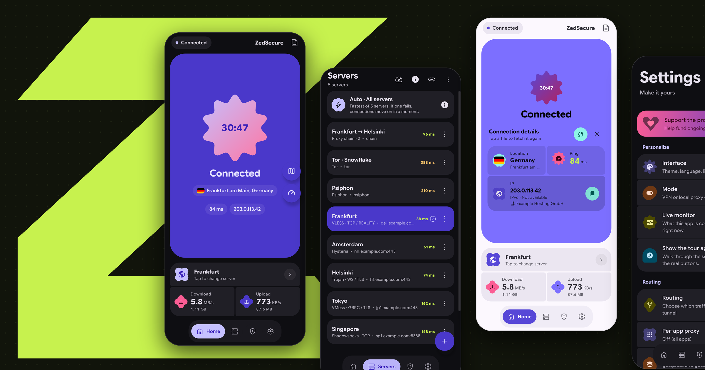

  

<h1 align="center">ZX VPN</h1>

<strong>Every way through, in one app.</strong>

  
  
  

<b>English</b> · <a href="README.fa.md">فارسی</a>

ZX VPN is a multi-engine VPN and proxy client. It brings several networking engines and connection
types together behind one interface, allowing users to manage configurations, subscriptions,
tunnel settings and connection diagnostics in one application.

  

> **Project status:** Engine availability differs by platform, build variant and release. The
> integrations below describe the project architecture; they do not guarantee that every protocol
> is present on every operating system or has been runtime-tested on every device. Check release
> notes before relying on a specific engine.

## Contents
- [Highlights](#highlights)
- [Engines and protocol support](#engines-and-protocol-support)
- [Aether integration](#aether-integration)
- [GHOST MOD](#ghost-mod)
- [Themes](#themes)
- [Configuration import and management](#configuration-import-and-management)
- [Connection tools](#connection-tools)
- [Platform support](#platform-support)
- [Download and installation](#download-and-installation)
- [Build from source](#build-from-source)
- [Repository layout](#repository-layout)
- [Troubleshooting](#troubleshooting)
- [Privacy and security notes](#privacy-and-security-notes)
- [Credits](#credits-and-third-party-software)
- [License](#license)

## Highlights
- **Multi-engine architecture:** multiple VPN, proxy and tunnel engines in one client.
- **Configuration management:** import, organize and use supported connection links and files.
- **Subscriptions:** manage subscription sources and refresh server lists where supported.
- **Server testing:** test available endpoints and select a responsive candidate. Failover behavior
  depends on the selected connection mode and platform.
- **Connection chaining:** route one supported engine through another.
- **Per-app routing:** choose which Android applications use the VPN tunnel.
- **Advanced routing:** edit GeoIP/GeoSite-based rules where supported by the selected core.
- **DNS utilities:** DNS tunnel modes, resolver tests and DNS-related connection options.
- **Diagnostics:** live logs, speed tests and MTU discovery.
- **Vault sharing:** share configurations as .zsx packages, with optional password protection and
  expiry metadata.
- **Modern interface:** Material 3 Expressive, light and dark themes, and multilingual UI.
- **Desktop client:** shared project foundation for supported Linux, Windows and macOS builds.

## Engines and protocol support

The table summarizes integrations documented by the project. Availability depends on the platform
and the engine packaged in a particular build.

| Engine / component | Project-documented use cases |
|---|---|
| **Xray** | VLESS (including Reality, Vision and XHTTP variants), VMess, Trojan, Shadowsocks, Hysteria2, and supported WireGuard / AmneziaWG configurations |
| **sing-box** | TUIC, Naive, AnyTLS, ShadowTLS, OpenVPN .ovpn files and sing-box JSON |
| **Psiphon** | Psiphon's own network service; a user-provided server is not required |
| **Tor** | Tor connections and bridge transports including obfs4, Snowflake and Conjure, subject to the packaged build |
| **DNS tunnels** | DNSTT, VayDNS and MasterDNS; supported transports include UDP, TCP, DoT and DoH |
| **OpenConnect** | Cisco AnyConnect-compatible VPN gateways |
| **IKEv2** | Android platform IPsec/IKEv2 VPN integration |
| **SSH** | Standalone SSH tunnel mode and supported chaining scenarios |
| **Aether (Android)** | An additional Android-focused integration combining the Cluvex Aether base with QW-patched native components. Build and runtime readiness are release-dependent. |

## Aether integration

The ZX Android source includes an Aether integration path intended to combine the two Aether code
lines behind one engine entry:

- CluvexStudio Aether is used as the upstream base.
- QW-AI-Code Aether-derived native components and dependency adaptations are incorporated into
  the merged source tree used by the Android build.
- The Android build helper checks upstream/merged core version parity and a patch-level marker,
  builds the native executable for configured Android ABIs, and checks dynamic dependencies before
  packaging.
- Aether has its own profile model and settings, separate from existing engine profiles.

This section describes the integration and build architecture, not a guarantee of production
readiness. A successful compilation or APK package does **not** prove that a VPN tunnel connects
correctly on a physical device. Runtime connectivity, routing and lifecycle behavior must be
validated independently for each release.

Upstream projects: [CluvexStudio/Aether](https://github.com/CluvexStudio/Aether) ·
[QW-AI-Code/Aether](https://github.com/QW-AI-Code/Aether)

### Smart config

**Servers → “+” → Smart config** builds a ready-to-use Aether profile from your own network:

- Detects the network type (mobile data, Wi-Fi, Ethernet) and your country/IPv6 status.
- Runs a fast parallel reachability probe of the Cloudflare edge and the WARP registration API
  (about 3.5 s at most) and shows each step live with its latency.
- Picks the transport (HTTP/3 or HTTP/2), anti-DPI profile (`noize`), scan depth, ClientHello
  fragmentation and an alternate API address for registration when the default one is blocked.
- Creates and activates the profile in one tap, or opens the manual editor with everything
  pre-filled.

### Connection ladder

When an Aether profile starts, ZX tries the profile first and then progressively more conservative
variants (other HTTP version, fragmented ClientHello with the strongest obfuscation, alternate API
address, WireGuard, plain) until real traffic passes through the local SOCKS listener. If nothing
works, the error contains the engine's last output lines so the cause can be reported.

> The ladder and Smart config improve the odds on filtered networks; they cannot guarantee a
> connection. Validate on a real device for each release.

## GHOST MOD

GHOST MOD groups ZX's anti-censorship helpers: anti-DPI tuning, the auto-tuner and related
options (see the in-app descriptions). It also includes **Anti-Porn** (family-safe browsing):

- Blocks adult domains and keywords at the routing layer and uses a family-filtering DNS.
- Blocks well-known DNS-over-HTTPS endpoints so browsers cannot bypass the DNS filter.
- Lets you add your own domains to block (up to 500).

Anti-Porn is a best-effort filter: access by raw IP address or through another VPN is outside
its reach.

## Themes

ZX VPN ships several complete interface designs, selectable in Settings:

| Design | Character |
|---|---|
| **Bento** | Rounded tiles, calm Material 3 Expressive look |
| **Pixel** | Pixel/Material-You flavored layout |
| **Old** | The classic layout |
| **ZX** | Cyberpunk neon design with day/night modes, an adjustable animation level and a PS5-style home (card deck, dynamic accent background, button glyph hints) |
| **ZX PS** | Glass-style design with personalizable palettes, tile shapes and a floating glass navigation bar |

The launcher icon and the app label (“ZX VPN”) are the same in every theme.

## Configuration import and management

Depending on the platform and enabled engine, ZX supports importing or opening:
- VLESS, VMess, Trojan, Shadowsocks and other supported share links.
- Xray JSON and sing-box JSON configurations.
- Supported subscription sources.
- OpenVPN .ovpn files.
- Amnezia vpn:// configuration links.
- QR codes containing supported links or configuration payloads.
- ZX Vault .zsx packages.
- Supported local files and links opened through Android share or file intents.

An item is usable only when its format is recognized and the corresponding engine is available in
the installed build. Importing a configuration does not guarantee that its remote server is
reachable or that the configuration is valid.

## Connection tools

### Server testing and selection
Server testing and automatic-selection workflows help compare available endpoints. Results depend
on network conditions, DNS resolution, server response and the test method. A low latency result
does not guarantee sustained throughput or reliability.

### Connection chaining
Where supported by the selected engines, one proxy can be routed through another. Example patterns
documented by the project include Xray through Tor and Tor through Xray. Available combinations
depend on the platform and engine implementation.

### DNS and resolver utilities
DNS-related tools include DNS tunnel modes and resolver diagnostics. The tunnel implementation
contains project-specific zeddns functionality alongside credited upstream components. Resolver
tests are diagnostic measurements and cannot guarantee that a resolver works on every network.

### Per-app and advanced routing
Android builds include per-app VPN routing controls. GeoIP/GeoSite rules and advanced options such
as SNI spoofing depend on the relevant core, platform permissions and, for root-only operations,
device root access.

### Vault sharing
Vault packages use the .zsx extension and are designed to share a configuration without exposing
its contents in the normal sharing flow. Password protection and expiry metadata are optional.
Treat exported packages as sensitive: they may contain credentials, server addresses or private
connection data.

## Platform support

| Platform | Project-documented engine coverage | Packaging |
|---|---|---|
| **Android** | Xray, sing-box, Psiphon, Tor, DNS tunnels, OpenConnect, IKEv2, SSH and the Aether integration path | ABI-specific APKs: arm64-v8a, armeabi-v7a and x86_64 |
| **Linux** | Xray, sing-box, DNS tunnels and SSH | .deb, .rpm, .AppImage, .tar.gz |
| **Windows** | Xray, sing-box, DNS tunnels and SSH | .msi, portable .zip |
| **macOS** | Xray, sing-box, DNS tunnels and SSH | .dmg for Apple Silicon and Intel |

This is a project-level summary, not a guarantee that every feature is enabled in every release.
Consult the release notes for the exact build you install.

## Download and installation

Download published builds from the official
[GitHub Releases page](https://github.com/hajighmony-sudo/Zx/releases).

### Android
1. Open the Releases page.
2. Select the APK matching your device:
   - **arm64-v8a:** most modern Android phones and tablets.
   - **armeabi-v7a:** older 32-bit ARM devices.
   - **x86_64:** Android x86-64 devices and selected emulator environments.
3. Install the APK and review Android's VPN permission prompt when starting a connection.

Install APKs only from sources you trust. If a release provides checksums, verify the downloaded
file before installing it.

### Linux
Choose the package supported by your distribution: DEB, RPM, AppImage or TAR.GZ. Follow the
distribution's installation procedure and grant any required network permissions.

### Windows
Use the MSI installer for a standard installation or the portable ZIP. Some VPN and network-driver
operations may require elevated permissions.

### macOS
Choose the DMG for Apple Silicon or Intel. The project currently documents that its macOS
application is not notarized, so macOS may display a security warning on first launch. Proceed only
if you have verified that the build came from the official project release.

## Build from source

### Requirements

For Android:
- Git with submodule support.
- JDK 21 for the current CI configuration.
- Android SDK and Android NDK.
- Rust stable toolchain.
- Rust targets: aarch64-linux-android, armv7-linux-androideabi and x86_64-linux-android.
- cargo-ndk for the Aether native build on the ZX branch.
- Python 3 for the Aether dependency patch/verification helper.
- Android SDK build tools and the Gradle wrapper included in the repository.

For desktop builds, use a compatible JDK and the native packaging dependencies required by the
target operating system and Compose Desktop packaging toolchain.

### Clone the repository

Clone with submodules so pinned native sources are available:

~~~sh
git clone --recurse-submodules https://github.com/hajighmony-sudo/Zx.git
cd Zx
git checkout ZX
git submodule update --init --recursive
~~~

### Android debug build

On the ZX branch, build the Aether native engine before Gradle packages the Android app:

~~~sh
rustup toolchain install stable --profile minimal
rustup default stable
rustup target add aarch64-linux-android armv7-linux-androideabi x86_64-linux-android
cargo install cargo-ndk --locked

bash ./tools/build-aether-engine.sh
./tools/get-cores.sh android
./gradlew --no-daemon :app:assembleDebug
~~~

The debug build is configured to produce ABI-specific APKs. The CI workflow verifies APK
signatures and, when successful, publishes APK files and a SHA-256 checksum file as workflow
artifacts.

### Android release build

~~~sh
bash ./tools/build-aether-engine.sh
./tools/get-cores.sh android
./gradlew :app:assembleRelease
~~~

Release signing depends on local keystore configuration. Never commit signing keys, keystore
passwords or other credentials to the repository.

### Desktop packages

Fetch the platform's pinned engine binaries and run the matching Gradle packaging task:

~~~sh
./tools/get-cores.sh linux
./gradlew :desktop:packageDeb
./gradlew :desktop:packageRpm
./gradlew :desktop:packageAppImage
~~~

For Windows, use the windows target with :desktop:packageMsi. For macOS, use macos-arm64 or
macos-x86_64 with :desktop:packageDmg.

### Pinned engine sources
The project uses pinned engine/core revisions instead of relying on arbitrary latest upstream
builds. The core manifest is maintained in [tools/cores.txt](tools/cores.txt); build scripts and
release workflows determine which pinned source or prebuilt core is used for each target.

## Repository layout

| Path | Purpose |
|---|---|
| app/ | Android application, VPN service, platform integration and resources |
| shared/ | Shared Kotlin Multiplatform domain logic, configuration models and UI |
| desktop/ | Compose Desktop application and native package configuration |
| gradle/ | Gradle version catalog and build configuration |
| tools/ | Core acquisition, native build and maintenance scripts |
| native/ | Native engine sources and submodules, including Aether-related source trees |
| .github/workflows/ | CI workflows for builds and release automation |
| docs/ | Screenshots and documentation assets |
| NOTICE | Third-party software notices and license attributions |
| LICENSE | Main project license |

## Troubleshooting

### Android build cannot find a core
Initialize submodules and run the core acquisition script:

~~~sh
git submodule update --init --recursive
./tools/get-cores.sh android
~~~

Confirm that required files exist and that the download step completed without errors.

### Aether build reports a missing NDK
Install the Android NDK and set ANDROID_NDK_HOME to its installation directory. The helper also
checks the Android SDK's default NDK location. When building in Linux CI, ensure that the NDK
contains the Linux host toolchain.

### Aether build reports a missing Rust target
Install the target matching the requested Android ABI:

~~~sh
rustup target add aarch64-linux-android armv7-linux-androideabi x86_64-linux-android
~~~

Also confirm cargo-ndk is installed and available on PATH.

### Aether version or patch-level validation fails
Do not bypass validation. It prevents building mismatched upstream and merged core versions or an
unidentified patch set. Update the intended submodules and review the Aether merge metadata before
rebuilding.

### APK builds but the VPN does not connect
A successful Gradle build confirms compilation and packaging, not end-to-end connectivity. Check
the in-app log, selected engine, configuration format, server availability and Android VPN
permission. For Aether, confirm that the exact release has passed device-level tunnel and routing
tests.

### Desktop packaging fails
Run the packaging task on a supported host OS, verify that the JDK is available, and install the
native packaging tools required by that target. Review the first failing Gradle task rather than
only the final summary line.

### Report a reproducible issue
Include:
- ZX version and platform.
- Device architecture or operating-system version.
- Selected engine and configuration type (remove credentials and private server details).
- Steps to reproduce.
- Relevant error text or a sanitized log excerpt.
- Whether the issue occurs on a clean install or after an upgrade.

Never attach passwords, private keys, subscription URLs, access tokens or unredacted configuration
files to a public issue.

## Privacy and security notes
- VPN operation requires operating-system VPN permission and may route device traffic through the
  selected remote endpoint.
- Import configurations and subscription links only from sources you trust.
- Treat share links, subscription URLs, Vault packages and diagnostic logs as potentially sensitive.
- Review per-app routing and DNS settings before connecting, especially on shared or managed devices.
- Root-only features require root access and should be enabled only when you understand their effect.
- ZX VPN is a client application. It does not make an unknown VPN server trustworthy and does not
  guarantee anonymity, censorship resistance, speed or uninterrupted connectivity.
- Use the software in accordance with local law and the terms that apply to the networks and
  services you access.

## Credits and third-party software

ZX VPN is built with and alongside open-source projects. Major upstream components include:
- [Xray-core](https://github.com/XTLS/Xray-core)
- [sing-box](https://github.com/SagerNet/sing-box)
- [Psiphon Tunnel Core](https://github.com/Psiphon-Labs/psiphon-tunnel-core)
- [Tor Project](https://www.torproject.org/)
- [MasterDnsVPN](https://github.com/masterking32/MasterDnsVPN)
- [AmneziaWG](https://github.com/amnezia-vpn/amneziawg-go)
- [OpenConnect](https://www.infradead.org/openconnect/)
- [hev-socks5-tunnel](https://github.com/heiher/hev-socks5-tunnel)
- [zeptun](https://github.com/Noisemux/zeptun)
- [VayDNS](https://github.com/net2share/vaydns)
- [dnstt](https://www.bamsoftware.com/software/dnstt/)
- [SlipNet](https://github.com/anonvector/SlipNet), acknowledged for design ideas and historical
  components used in the DNS tunnel implementation.
- [CluvexStudio Aether](https://github.com/CluvexStudio/Aether) and
  [QW-AI-Code Aether](https://github.com/QW-AI-Code/Aether) for the Android Aether integration work.

The DNS tunnel implementation includes the project's own zeddns engine. Versions before 3.0.9
used SlipNet engine components; from 3.0.9 onward, the project documents its own zeddns
implementation while retaining attribution for the ideas and components that inspired it.

See [NOTICE](NOTICE) for detailed third-party notices, component-specific licenses, patches and
attributions. Each upstream component remains subject to its own license.

## License

The main project is distributed under the [GNU Affero General Public License v3.0](LICENSE)
(AGPL-3.0). Some bundled or linked components use their own licenses, as detailed in
[NOTICE](NOTICE). Review the relevant upstream license before redistributing a modified build.
