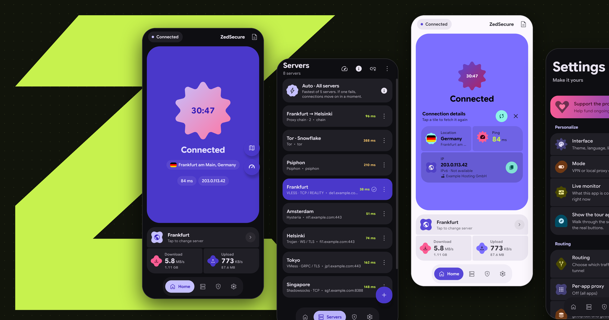

<p align="center">
  
</p>

<h1 align="center">ZX VPN</h1>

<p align="center">Every way through, in one app.</p>

<p align="center">
  <a href="https://github.com/AMINOPY/ZX-VPN-/releases/latest"></a>
  <a href="https://play.google.com/store/apps/details?id=com.zx-vpn.vpn"></a>
  
  <a href="LICENSE"></a>
</p>

<p align="center"><b>English</b> · <a href="README.fa.md">فارسی</a></p>

## What is ZX VPN?

ZX VPN is a VPN and proxy client for Android, Linux, Windows and macOS that ships with more than one
engine. When one route is blocked, the next one is already installed: Xray and sing-box for the
usual protocols, Psiphon and Tor for when nothing else connects, DNS tunnels for networks that let
little more than DNS through, and WireGuard, AmneziaWG, OpenConnect and IKEv2 for servers you
already run. Engines can be chained through each other, and one tap tests every server and moves
the connection to the fastest one.

<p align="center">
  
</p>

## Engines

| Engine | Carries |
|---|---|
| Xray | VLESS with Reality, Vision and XHTTP, VMess, Trojan, Shadowsocks, Hysteria2, WireGuard, AmneziaWG |
| sing-box | TUIC, Naive, AnyTLS, ShadowTLS, OpenVPN `.ovpn` files, and plain sing-box JSON |
| Psiphon | Psiphon's own network; no server of yours needed |
| Tor | obfs4, Snowflake and Conjure bridges |
| DNS tunnels | DNSTT, VayDNS and MasterDNS, over UDP, TCP, DoT or DoH |
| OpenConnect | Cisco AnyConnect and compatible gateways |
| IKEv2 | the IPsec client built into Android |
| SSH | on its own, or through any of the above |

Android has all of them. Linux, Windows and macOS carry Xray, sing-box, the DNS tunnels and SSH.

## Features

- Imports share links, subscriptions, Xray and sing-box JSON, `.ovpn`, Amnezia `vpn://` and QR codes
- Auto-select keeps the tunnel on the fastest server and fails over on its own
- Chains in both directions, for example Xray over Tor or Tor over Xray
- Per-app routing, a geoip/geosite rule editor, and SNI spoofing on rooted devices
- Vault: share a config as a `.zsx` file that connects without showing it, with an optional password and expiry date
- Speed test, MTU finder, DNS resolver scanner and a live log
- Material 3 Expressive, light and dark, in English, Persian, Russian and Chinese

## Download

**Android:** [Google Play](https://play.google.com/store/apps/details?id=com.zx-vpn.vpn), or the
APK for your device from [Releases](https://github.com/AMINOPY/ZX-VPN-/releases/latest)
(`arm64-v8a` for almost every phone, `armeabi-v7a` for older ones).

**Linux:** `.deb`, `.rpm`, `.AppImage` or `.tar.gz` from Releases. On Arch Linux, the community
package [`zx-vpn-bin`](https://aur.archlinux.org/packages/zx-vpn-bin) is in the AUR:
`yay -S zx-vpn-bin`. On NixOS, `nix run github:CluvexStudio/ZX VPN`.

**Windows:** the `.msi` installer, or the portable `.zip`.

**macOS:** the `.dmg` for Apple Silicon or for Intel. The app is not notarized, so open it the
first time with right-click, then Open.

## Building

```sh
./tools/get-cores.sh android     # or linux, windows, macos-arm64, macos-x86_64
./gradlew :app:assembleRelease   # three APKs, one per ABI
./gradlew :desktop:packageDeb    # or packageRpm, packageMsi, packageDmg
```

Every engine is built in [ZX VPN-Cores](https://github.com/CluvexStudio/ZX VPN-Cores), one
workflow per engine, from the forks and exact commits in its `pins.txt`. [`tools/cores.txt`](tools/cores.txt)
names the build each release takes. Pushing a `v*` tag builds Android and every desktop system in CI
and puts them all in one release; Android and desktop share one version.

## Credits

The DNSTT and VayDNS modes of the DNS tunnel are built with the
[VayDNS](https://github.com/net2share/vaydns) library, a fork of [dnstt](https://www.bamsoftware.com/software/dnstt/). The MasterDNS mode is a separate engine, credited below.

The main ideas of the tunnel come from [SlipNet](https://github.com/anonvector/SlipNet) by anonvector: DNS over plain TCP (VayDNS does not have this by itself), the fan-out and round-robin resolver modes with spread count, the DNS pool that picks the fastest resolvers on each connect, the global resolver override and prevent-DNS-fallback settings, and the design and text of the DNS and SSH settings.

Versions before 3.0.9 used SlipNet's own engine, including its TCP transport, inside the core. Since 3.0.9, the engine is `zeddns`, written for this app. It has the same features, but with its own code.

ZX VPN also stands on [Xray-core](https://github.com/XTLS/Xray-core), [sing-box](https://github.com/SagerNet/sing-box), [Psiphon](https://github.com/Psiphon-Labs/psiphon-tunnel-core), [Tor](https://www.torproject.org/), [MasterDnsVPN](https://github.com/masterking32/MasterDnsVPN), [AmneziaWG](https://github.com/amnezia-vpn/amneziawg-go), [OpenConnect](https://www.infradead.org/openconnect/), [hev-socks5-tunnel](https://github.com/heiher/hev-socks5-tunnel), and [zeptun](https://github.com/Noisemux/zeptun). Their licences are in [NOTICE](NOTICE).

## License

[AGPL-3.0](LICENSE). The core also links sing-box, Psiphon and sing-openvpn, which are GPL-3.0;
section 13 of GPL-3.0 allows combining them with AGPL-3.0 code, and each keeps its own licence.
